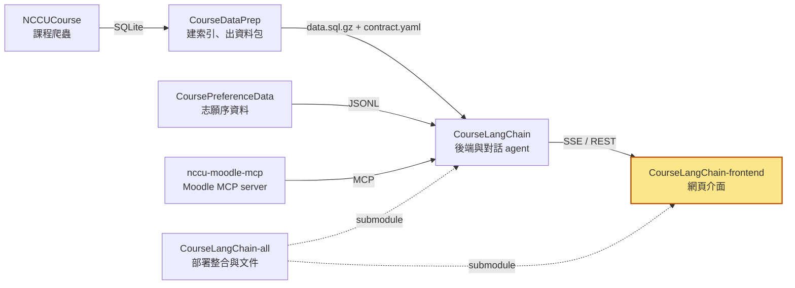

# CourseLangChain-frontend 文件

> 最後確認：2026-11-15，對照 `feat/course-card-and-onboarding`（PR #1，尚未合併；`main` 仍停在 2023 年的版本）。
> 文件與程式不一致時，以程式為準，並請更新本文件。

政大選課助理的**網頁介面**：左邊聊天，右邊是課表面板。

---

## 摘要

學生在這裡用中文提問，看到候選課程、排課方案與課表；查到的課程可以點開看詳細資料、一鍵加入課表。
介面的原則是**模型負責說話，畫面負責正確**：課程卡片、排課方案的「套用」按鈕都直接使用後端送來的結構化資料，
課號不經過語言模型轉述，因此不會被抄錯。

| 功能 | 說明 |
|---|---|
| 聊天 | 串流顯示回答、目前在做哪一步與已耗時間、可中途停止 |
| 候選課程卡片 | 查課結果附「加入課表」按鈕；點開看課綱、評量、官方連結 |
| 排課方案 | 每個方案一鍵套用到課表 |
| 課表面板 | 週課表與清單兩種檢視、學分合計、手動輸入課號加課、衝堂自動替換 |
| 志願序清單 | 依課表列出要填的志願序；每門課顯示「第 k 志願，約 X%」的選上機率（只有通識與體育有官方資料）；「建議排序」算出期望選上門數最多的排法，使用者確認後才套用 |
| Moodle 登入、成績單上傳 | 個人化查詢（只存在記憶體，不落地） |
| 使用說明 | 一頁式操作指引 |

## 在系統中的位置



與課程檢索的關係：後端檢索到的候選課程以 SSE 側通道 `{"type": "courses", …}` 送來，
由 `CourseCandidates.vue` 畫成卡片；點開卡片時呼叫 `GET /api/courses/{course_id}` 取詳細資料。
檢索本身的說明見 [CourseLangChain/docs/RETRIEVAL.md](https://github.com/NCCU-AI-SYSTEM/CourseLangChain/blob/main/docs/RETRIEVAL.md)。

---

## 開發者指南

### 啟動

需要 Node.js 20 與 pnpm（不要用 npm 或 yarn，版本鎖在 `pnpm-lock.yaml`）。

```sh
pnpm install
pnpm dev          # http://localhost:3000，/api 由 Vite 轉給 http://localhost:8000
pnpm build        # 型別檢查（vue-tsc）後輸出到 dist/
```

正式環境沒有 Node：nginx 直接提供 `dist/` 的靜態檔，`/api/` 轉給後端（設定在 CourseLangChain-all 的 `nginx.conf`）。
**改了前端要重新 `pnpm build`**，nginx 才會拿到新版；`dist/` 若是 root 擁有，先 `sudo chown -R $USER:$USER dist`。

### 技術棧

Vue 3（`<script setup>`）＋ TypeScript ＋ Vite ＋ Tailwind CSS ＋ daisyUI；
SSE 用 `@vueuse/core` 的 `useEventSource`（瀏覽器原生 EventSource，`Chat.vue`）。
`package.json` 裡的 `@microsoft/fetch-event-source` 目前沒有被使用。

### 目錄

```
src/
  App.vue                  版面：導覽列、聊天、課表面板、課程卡片、使用說明
  components/
    NavBar.vue             新對話、使用說明、Moodle 登入、主題切換
    Intro.vue              首頁引導與範例問題、成績單上傳
    Chat.vue               訊息串流、進度與耗時、停止生成
    CourseCandidates.vue   候選課程卡片（加入課表）
    SchedulePlans.vue      排課方案（一鍵套用）
    SchedulePanel.vue      右側課表面板（週課表 / 清單、加課）
    WeekTimetable.vue      週課表格線
    PreferenceList.vue     志願序清單
    CourseDetail.vue       課程詳細資料（課綱、評量、官方連結）
    HelpGuide.vue          使用說明
    MoodleLogin.vue        Moodle 帳密（只送後端記憶體）
    TranscriptUpload.vue   成績單上傳
    Theme.vue              深淺色主題
    VoiceInput.vue         語音輸入（目前沒有掛載）
  composables/             狀態與邏輯：useChat、useSchedule、useSession、usePreference、
                           useCourseDetail、useHelpGuide、useMoodle、useProfile、usePeriods、
                           useTimetableLayout、useMarkdown
  utils/api.ts             所有 API 呼叫
  utils/courseText.ts      課程卡片的文字處理
```

### 呼叫的後端 API

| API | 用途 |
|---|---|
| `GET /api/ask` | 對話（SSE） |
| `GET /api/terms` | 可選學期 |
| `GET /api/courses/{course_id}` | 課程卡片 |
| `/api/schedule`、`POST /api/schedule/apply` | 課表面板、套用排課方案 |
| `POST /api/preference/chances` | 志願序清單的選上機率（`rank` 是第幾列，不是 33/66/99） |
| `POST /api/preference/optimize` | 建議排序 |
| `/api/profile` | 成績單 |
| `/api/moodle` | Moodle 登入狀態 |

SSE 的訊息格式：`{"data": "文字"}` 是回答，`{"data": "SPECIAL_END_TOKEN"}` 表示結束；
`{"type": "status" | "courses" | "plans", …}` 是側通道，分別是進度提示、候選課程、排課方案。

### 測試

純邏輯的測試不需要瀏覽器：

```sh
npx tsx src/utils/courseText.test.ts
npx tsx src/composables/usePreference.test.ts
npx tsx src/composables/useTimetableLayout.test.ts
```

### 已知問題

- **`main` 停在 2023 年。** 目前所有功能都在 PR #1，要等後端 PR #7（課程卡片 API）合併後再合併。
- 後端剛啟動的 30 ~ 50 秒內提問會顯示「連線中斷，EventSource 事件：error」，是後端還沒就緒，不是前端的問題。
- 含英文字母的課號（115-1 有 131 門）不會出現在候選課程卡片，原因在後端（見 RETRIEVAL.md 的已知問題）。
- 排課方案的「上課日」順序錯誤（例如「一三二四」），原因在後端 `tools/scheduler.py`。
- 根目錄的 `README.md` 仍是 Vite 範本的內容。

## 相關文件

- [部署整合文件：前端](https://github.com/NCCU-AI-SYSTEM/CourseLangChain-all/blob/main/docs/developer/frontend.md)
- [使用者手冊](https://github.com/NCCU-AI-SYSTEM/CourseLangChain-all/blob/main/docs/user/README.md)
- [後端文件](https://github.com/NCCU-AI-SYSTEM/CourseLangChain/blob/main/docs/README.md)
